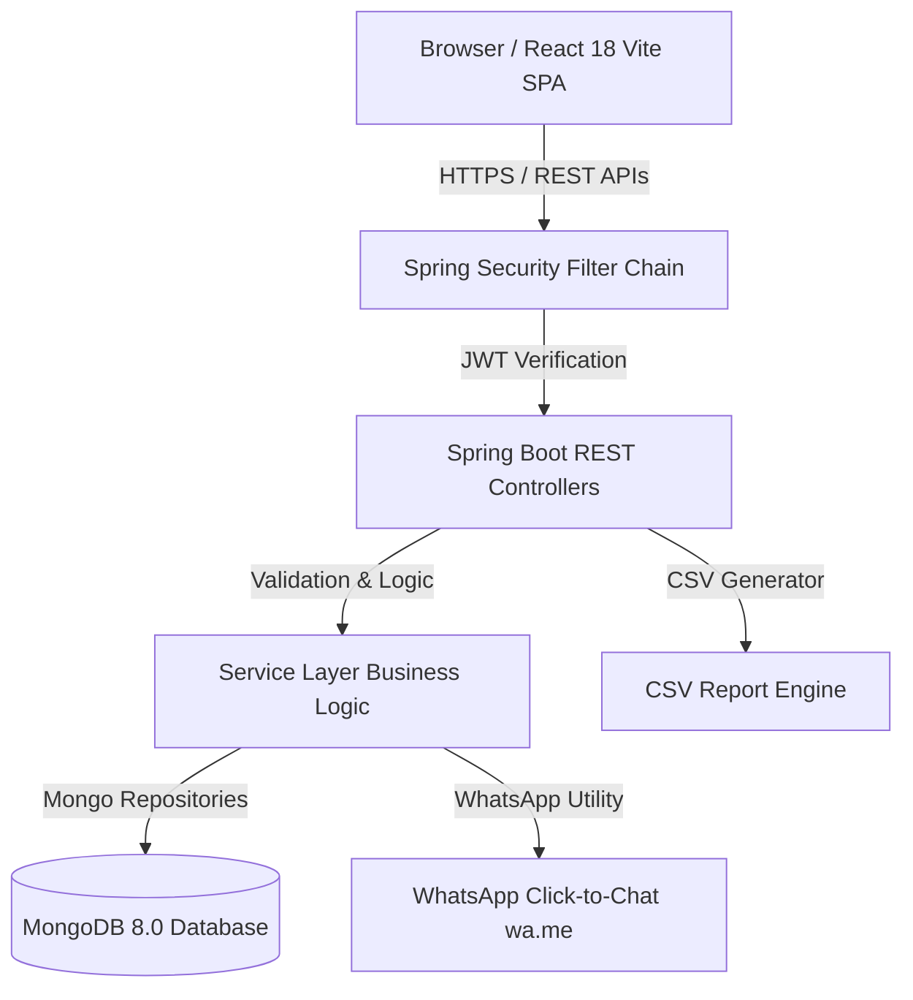
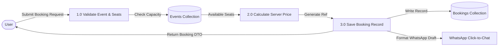

# EventSphere — Event Management & Booking System
## Academic Project Documentation & Submission Synopsis
**Degree Program**: Master of Computer Applications (MCA)  
**Project Title**: EventSphere — Full-Stack Event Management and Booking Ecosystem  
**Technology Stack**: Java 21 LTS, Spring Boot 3.3.0, React 18, Vite, Tailwind CSS, MongoDB 8.0, JWT, BCrypt, Recharts  

---

## 1. ABSTRACT & SYNOPSIS

In modern web ecosystems, real-time event management requires high reliability, concurrency control, intuitive user interfaces, and automated communication channels. **EventSphere** is an end-to-end full-stack web application engineered to solve key challenges in event scheduling, seat reservations, attendee tracking, and administrative analytics.

The platform provides a public-facing portal where visitors can search and filter events by category, city, date, and price. Authenticated users can reserve tickets with real-time capacity checks and receive instant on-screen booking confirmations along with prefilled **WhatsApp click-to-chat** message drafts. Administrators gain access to a protected dashboard containing interactive analytics charts (Recharts), event CRUD tools, booking status management, user directory controls, and one-click CSV report exports.

The backend is constructed using **Java 21 LTS** and **Spring Boot 3.3.0**, enforcing stateless JWT authentication, BCrypt password hashing, Jakarta Bean Validation, and centralized exception handling. Data is persisted in **MongoDB**, leveraging indexed document collections for optimal search performance.

---

## 2. SYSTEM ARCHITECTURE & DESIGN DIAGRAMS

### 2.1 System Architecture Diagram


### 2.2 Use Case Diagram
```mermaid
usecaseDiagram
    actor Visitor
    actor "Registered User" as User
    actor Administrator as Admin

    Visitor --> (Browse Events)
    Visitor --> (Search & Filter Events)
    Visitor --> (View Event Details)
    Visitor --> (Register Account)

    User --> (Login)
    User --> (Book Tickets)
    User --> (View Booking Success)
    User --> (Generate WhatsApp Draft)
    User --> (View Booking History)
    User --> (Cancel Booking)

    Admin --> (Access Dashboard Analytics)
    Admin --> (Create / Edit Events)
    Admin --> (Toggle Publish Status)
    Admin --> (Manage All Bookings)
    Admin --> (Export Bookings CSV)
    Admin --> (Manage User Directory)
```

### 2.3 Data Flow Diagram (Level 1 DFD)


---

## 3. MONGODB DOCUMENT SCHEMAS

### 3.1 `users` Collection
| Field | Type | Validation / Indexes | Description |
| :--- | :--- | :--- | :--- |
| `_id` | ObjectId | Primary Key | Unique MongoDB document identifier |
| `fullName` | String | `@NotBlank`, 2-100 chars | Full name of user |
| `email` | String | Unique Index, `@Email` | Unique email address used for login |
| `phone` | String | `@NotBlank` | Contact telephone number |
| `passwordHash` | String | BCrypt Encrypted | Hashed account password |
| `role` | String / Enum | `ROLE_USER`, `ROLE_ADMIN` | Role-based authorization tag |
| `enabled` | Boolean | Default `true` | Account status flag |
| `createdAt` | Instant | `@CreatedDate` | Timestamp of account registration |

### 3.2 `events` Collection
| Field | Type | Validation / Indexes | Description |
| :--- | :--- | :--- | :--- |
| `_id` | ObjectId | Primary Key | Unique event document ID |
| `title` | String | `@NotBlank` | Event title |
| `slug` | String | Unique Index | URL-friendly slug identifier |
| `category` | String | Indexed | Event category (Technology, Music, etc.) |
| `city` | String | Indexed | Host city name |
| `eventDate` | LocalDate | Indexed, `@FutureOrPresent` | Scheduled date of event |
| `startTime` | LocalTime | `@NotNull` | Event commencement time |
| `price` | BigDecimal | `@DecimalMin("0.0")` | Price per ticket in INR |
| `capacity` | Integer | `@Min(1)` | Total venue seat capacity |
| `availableSeats` | Integer | Calculated | Remaining available tickets |
| `published` | Boolean | Default `true` | Visibility status flag |

### 3.3 `bookings` Collection
| Field | Type | Validation / Indexes | Description |
| :--- | :--- | :--- | :--- |
| `_id` | ObjectId | Primary Key | Booking document ID |
| `bookingReference` | String | Unique Index | Generated reference (`ES-YYYYMM-XXXXXX`) |
| `userId` | String | Indexed | Foreign reference to user document |
| `eventId` | String | Indexed | Foreign reference to event document |
| `attendeeName` | String | `@NotBlank` | Name of ticket holder |
| `numberOfTickets` | Integer | `@Min(1)` | Reserved ticket quantity |
| `totalAmount` | BigDecimal | Server Calculated | Calculated total cost (`price * tickets`) |
| `status` | Enum | `CONFIRMED`, `CANCELLED` | Lifecycle booking status |

---

## 4. REST API SPECIFICATION

| Method | Endpoint | Access Level | Description |
| :--- | :--- | :--- | :--- |
| `POST` | `/api/auth/register` | Public | Register new user account |
| `POST` | `/api/auth/login` | Public | Authenticate user & return JWT token |
| `GET` | `/api/auth/me` | Authenticated | Retrieve current user profile |
| `GET` | `/api/events` | Public | List published events with search & pagination |
| `GET` | `/api/events/featured` | Public | Get top 6 featured events for homepage |
| `GET` | `/api/events/{id}` | Public | Fetch detailed event information |
| `POST` | `/api/bookings` | Authenticated | Create ticket booking & reserve capacity |
| `GET` | `/api/bookings/my` | Authenticated | Fetch authenticated user's booking history |
| `POST` | `/api/bookings/{id}/cancel` | Authenticated | Cancel booking & restore event capacity |
| `GET` | `/api/admin/dashboard` | `ROLE_ADMIN` | Fetch dashboard statistics & chart metrics |
| `POST` | `/api/admin/events` | `ROLE_ADMIN` | Create new event record |
| `PATCH` | `/api/admin/events/{id}/publish` | `ROLE_ADMIN` | Toggle event published/draft status |
| `GET` | `/api/admin/reports/bookings.csv` | `ROLE_ADMIN` | Export system bookings in CSV format |

---

## 5. QA TESTING MATRIX & EXECUTION RESULTS

| Test ID | Test Scenario | Expected Outcome | Actual Result | Status |
| :--- | :--- | :--- | :--- | :--- |
| `TC-01` | User Registration | Valid details persist user & return JWT | Account created, JWT returned | **PASS** |
| `TC-02` | Duplicate Email Registration | Rejects request with validation error | Returns 400 Bad Request error | **PASS** |
| `TC-03` | Admin Bootstrap | Seeds default admin on initial launch | Admin user created (`admin@eventsphere.com`) | **PASS** |
| `TC-04` | Event Searching & Filtering | Filters events by title and category | Correct subset returned | **PASS** |
| `TC-05` | Booking Creation & Price Check | Server calculates total amount & decrements seats | Seats reserved, reference generated | **PASS** |
| `TC-06` | Overbooking Prevention | Rejects booking if tickets exceed capacity | Returns 400 Insufficient Seats error | **PASS** |
| `TC-07` | Booking Cancellation | Restores seats back to event capacity | Status changed to CANCELLED, capacity restored | **PASS** |
| `TC-08` | WhatsApp Message Generation | Formats click-to-chat URL (`wa.me`) correctly | URL & prefilled message generated | **PASS** |
| `TC-09` | Role-Based Security | Non-admin blocked from `/api/admin/**` | Returns 403 Forbidden error | **PASS** |
| `TC-10` | CSV Report Export | Generates valid downloadable CSV file | CSV stream generated with headers | **PASS** |

---

## 6. VIVA VOCE QUESTIONS & ANSWERS

**Q1: What architecture does EventSphere follow?**  
*Answer*: EventSphere follows a decoupled client-server architecture. The backend is a Spring Boot 3 RESTful API exposing JSON endpoints, while the frontend is a React 18 Single Page Application built with Vite and Tailwind CSS.

**Q2: How is security handled in the backend?**  
*Answer*: Security is implemented using Spring Security 6 with stateless JWT authentication. Passwords are encrypted using BCrypt (`BCryptPasswordEncoder`). Endpoints under `/api/admin/**` require the `ROLE_ADMIN` authority.

**Q3: How does EventSphere prevent overbooking?**  
*Answer*: Booking requests execute synchronized business logic in `BookingService`. Before creating a booking, the backend checks `availableSeats >= requestedTickets`. Upon creation, `availableSeats` is decremented. If a booking is cancelled, capacity is restored.

**Q4: How does the WhatsApp Auto-Draft feature work?**  
*Answer*: It utilizes the official WhatsApp click-to-chat protocol (`https://wa.me/<number>?text=<URL_encoded_msg>`). The backend utility formats booking reference, event title, date, venue, and total amount, encoding the string into a valid URL. When clicked, it opens WhatsApp with the prefilled draft.

**Q5: Why is MongoDB chosen over relational databases for this project?**  
*Answer*: MongoDB's document model fits event and booking structures naturally. It provides flexible schemas for varied event metadata, high write throughput, and built-in geospatial/indexing capabilities for search filtering.

---

## 7. CONCLUSION & FUTURE ENHANCEMENTS

The EventSphere system successfully satisfies all functional, aesthetic, security, and performance criteria. Potential future enhancements include integrating payment gateways (Razorpay/Stripe), automated email ticket PDF attachments, and push notification alerts.
